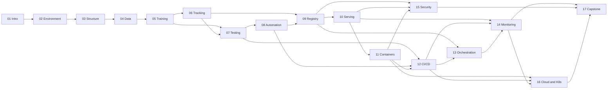

# Learning Roadmap

This page answers three questions: what depends on what, how long each route takes, and how you know you are ready to move on.

Pick a route, then follow the module order inside it. The order is not a suggestion: Module 09 assumes a registry problem you only understand after Module 06, and Module 12 assumes tests from Module 07.

---

## 1. Three stages

The course is studied in three stages. Each stage has a different job, and each ends with a gate you can check yourself.

| Stage | Modules | What this stage is for | You are ready to move on when |
|---|---|---|---|
| **Beginner** | 01-03 | Understanding why models fail in production, and building an environment and project that do not. | A clean copy of your project installs and runs from your own instructions. |
| **Intermediate** | 04-11 | Making one model trustworthy: valid data, reproducible training, tracked decisions, tests, a registry, a service, a container. | A model is registered, served, and blocked from promotion when it fails a gate. |
| **Advanced** | 12-17 | Running the system: automation, drift, security, scale, incident response, handover. | Someone else can operate your system from your documentation. |

Stage and level are related but not identical. The stage is where you are in the journey; the **level** printed on each module is the difficulty of that module's material. Module 12, for example, sits in the Advanced stage and is labelled Advanced, while Module 11 sits in the Intermediate stage and is labelled Intermediate.

!!! tip "Not sure which stage you are in?"
    If you cannot yet rebuild your project environment from a clean copy, you are in the Beginner
    stage regardless of how much you have read. If a model is served but nothing monitors it,
    you are in Intermediate. The gates in Section 4 are the honest test.

---

## 2. Dependency graph

Solid arrows are hard prerequisites. You will be lost without them, not merely inconvenienced.

Reading the graph:

- **Nothing after Module 03 is safe without a reproducible environment.** That is why Module 02 is assessed by a checklist rather than a quiz.
- **Module 07 (testing) is a hub.** It feeds automation, CI, and the capstone. Skipping it does not fail you immediately; it fails you at Module 12.
- **Modules 15 and 16 are leaves.** They improve the capstone but are not prerequisites for it. This is what makes the Core capstone possible.
- **Module 17 has no new tool.** If you find yourself installing something new in the capstone, the scope has slipped.

---

## 3. The three routes

| Route | Weekly effort | Duration | Fits |
|---|---|---|---|
| **Intensive** | ~18 hours | 16 weeks | MLOps as a main subject in one semester |
| **Standard** | 9-10 hours | 30 weeks | Alongside three or four other courses |
| **Part-time** | ~7 hours | 40 weeks | Working, or studying at a slower pace |

All three reach the same outcomes. Only the calendar differs.

### 3.1 Intensive route (16 weeks)

Designed for a student whose main commitment is this course. Two modules are partly split across weeks, marked `a`/`b`.

| Week | Modules | Hours |
|---|---|---|
| 1 | 01, 02a | 14 |
| 2 | 02b, 03 | 18 |
| 3 | 04 | 14 |
| 4 | 05 | 16 |
| 5 | 06 | 14 |
| 6 | 07 | 16 |
| 7 | 08, 09a | 18 |
| 8 | 09b, 10a | 18 |
| 9 | 10b, 11 | 20 |
| 10 | 12 | 18 |
| 11 | 13 | 16 |
| 12 | 14 | 18 |
| 13 | 15, 16a | 24 |
| 14 | 16b | 12 |
| 15 | 17 (capstone part 1) | 24 |
| 16 | 17 (capstone part 2) | 24 |

**Total:** 284 hours. Weeks 13-16 are deliberately heavy; if you cannot sustain that, switch to the standard route rather than compressing the capstone.

### 3.2 Standard route (30 weeks)

The default recommendation. Each block is a module or a half-module.

| Weeks | Modules | Hours |
|---|---|---|
| 1 | 01 | 8 |
| 2-3 | 02 | 14 |
| 4 | 03 | 10 |
| 5-6 | 04 | 14 |
| 7-8 | 05 | 16 |
| 9-10 | 06 | 14 |
| 11-12 | 07 | 16 |
| 13 | 08 | 12 |
| 14-15 | 09 | 14 |
| 16-17 | 10 | 16 |
| 18-19 | 11 | 14 |
| 20-21 | 12 | 18 |
| 22-23 | 13 | 16 |
| 24-25 | 14 | 18 |
| 26 | 15 | 14 |
| 27-28 | 16 | 22 |
| 29-30 | 17 (capstone) | 48 |

The capstone is compressed into two weeks at 24 hours each in this table, which is not realistic alongside other courses. **In practice, stretch the capstone to four to six weeks** and stop treating weeks as equal; the total is what matters, not the grid.

### 3.3 Part-time route (40 weeks)

Same order, roughly half the weekly load. A module takes about 1.5 times as many weeks as its hours divided by seven. The capstone takes seven weeks.

The main risk on this route is losing context between sessions. Two habits prevent it:

- End every session by writing one sentence in a `progress.md` file: where you stopped and what you were about to do.
- Start every session by running the verification command from the last lab, so you know the environment still works before you build on it.

### 3.4 Essential-only route

If you must shorten the course, remove Modules 08, 13, 15, and 16 and take the Core capstone. That is roughly 200 hours and still reaches CO1-CO7 fully, with CO8 at a reduced level and CO9 not reached. Do not remove Modules 04, 07, or 14: each is the only primary home for an outcome, and removing them makes the capstone dishonest rather than smaller.

The [learning outcomes](../syllabus/learning-outcomes.md) page records exactly which outcome loses its only primary teaching if a module is dropped.

---

## 4. Milestones and gates

A milestone is a checkpoint with evidence. Do not proceed past a gate because the calendar says so; proceed because the evidence exists.

### M0 - Readiness (before Module 01)

- [ ] You can run a Python script, use `cd` and `ls`, and make a Git commit.
- [ ] Your machine meets the minimum hardware in [prerequisites](../prerequisites/index.md).
- [ ] You have a free GitHub account.
- [ ] You have completed the ten-minute self-check and know which modules to read carefully.

### M1 - Environment reproducible (after Module 02)

- [ ] A fresh folder installs your project with one documented command.
- [ ] `python --version` inside the environment prints 3.11 or 3.12.
- [ ] You can explain why a global install breaks another project.

### M2 - Data trustworthy (after Module 04)

- [ ] A corrupt batch is rejected with a useful message.
- [ ] You can name the exact dataset version that trained your model.
- [ ] You can explain why a random split would leak in this dataset.

### M3 - Training reproducible (after Module 05) → **MP1**

- [ ] Two clean runs produce metrics within your stated tolerance.
- [ ] Changing one parameter reruns only the affected stages.
- [ ] A colleague could repeat this without asking you a question.

### M4 - Model selected and registered (after Module 09) → **MP2**

- [ ] Your evaluation report identifies a slice where the aggregate winner loses.
- [ ] Promotion is blocked automatically for a failing candidate.
- [ ] Rollback is demonstrated and timed.

### M5 - Service gated (after Module 12) → **MP3**

- [ ] The API rejects malformed input with specific messages.
- [ ] The container builds from scratch and runs as non-root.
- [ ] CI fails on a data break, a unit regression, and a metric regression, each for the stated reason.

### M6 - Operated (after Module 14) → **MP4**

- [ ] Drift is detected a batch before the error becomes obvious.
- [ ] The alert has a threshold you can justify, an owner, and a first action.
- [ ] Retraining improves the affected slice without regressing another.

### M7 - Handover (Module 17)

- [ ] A peer deploys from your runbook in under 30 minutes.
- [ ] Rollback takes under five minutes.
- [ ] The incident simulation is diagnosed within 30 minutes.
- [ ] The model card states limitations and measured disparity honestly.

---

## 5. How to study a week

A repeatable pattern that works for self-study:

| Session | Focus | Output |
|---|---|---|
| 1 | Read the lesson; write the three definitions you did not know | A short note in your own words, not a copy |
| 2 | Do the guided lab, typing commands rather than pasting | Expected output matched, or a documented difference |
| 3 | Do the independent challenge; break something on purpose | A failure signature you can recognise again |
| 4 | Answer the knowledge check before looking at the key | A list of gaps, not a score |

Two rules that matter more than they look:

1. **Type commands.** Copy-paste hides which character broke the command, and hides the lesson.
2. **Write the error down.** A troubleshooting log you build yourself is the most useful artefact in the course, because it is the one you will actually consult later.

---

## 6. When you fall behind

Falling behind is normal; abandoning the course is what happens when the plan has no recovery path.

- **Missed a week?** Do not compress the module; drop the optional extension and move on. Extensions are labelled.
- **Stuck on a lab for over 90 minutes?** Read the troubleshooting table, then the relevant lesson section, then ask. Time-boxing prevents the spiral where one broken environment ends the course.
- **Environment broken beyond repair?** Rebuild from the repository rather than debugging for hours. That is what reproducibility is for, and the rebuild is itself practice.
- **Skipped a module and it now matters?** Go back. Modules 05, 07, and 09 are the ones that punish skipping hardest.
- **No time for the full capstone?** Take the Core variant. Do not take a capstone you cannot hand over; a smaller system you can operate is worth more than a larger one you cannot.

---

## 7. After the course

The outcomes are designed to be used, not admired. Reasonable next steps:

- **Rebuild the system on a dataset from your own domain**, keeping every acceptance criterion. This is the fastest way to discover what you actually internalised.
- **Teach one module to someone else.** The gaps in your understanding appear within ten minutes of explaining.
- **Read the primary documentation for the tools you used**, now that you know what problem each solves. Documentation is far easier to read with a question in mind.
- **Add one thing the course deliberately excluded**: a feature store, a managed cloud deployment, or distributed training. You will now be able to judge whether it solves a problem you have.
