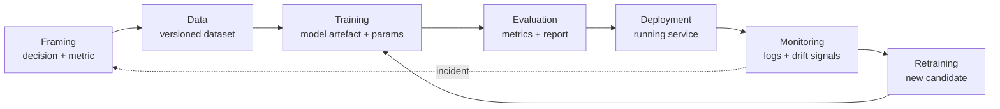

# Concepts · Module 01

## 1. What MLOps is

**MLOps** is the set of practices and controls that keep a machine-learning system correct while it is being changed, and after the world around it has changed.

Three parts of that sentence matter.

- *Practices and controls*, not products. A tool is one way to implement a control; the control is the thing that must exist.
- *While it is being changed*. A model that is never updated is a static file. MLOps is about the change process: who changed what, with which data, and how you proved it was safe.
- *After the world changed*. A model is a claim about the world, and the world does not hold still. Traffic patterns, prices, user behaviour, and upstream schemas all move.

A common beginner definition is "DevOps for machine learning". It is a useful first approximation and a bad final one. DevOps assumes the system's behaviour is determined by its code. In ML, behaviour is determined by code *and data* and *the relationship between them*, and none of those three stays fixed on its own schedule.

### Where the neighbouring disciplines end

| Discipline | Owns | Typical question | Stops where |
|---|---|---|---|
| Data engineering | Moving and shaping data reliably | "Did the batch arrive, complete, and match the schema?" | It hands over a table; it does not claim the table predicts anything |
| Machine learning engineering | Model quality and training code | "Does this model predict well on held-out data?" | It hands over an artefact; it does not claim it is safe to serve |
| DevOps / platform | Runtime, deployment, reliability of services | "Is the service up, and can we deploy it repeatedly?" | It keeps the service running; it does not know whether predictions are still good |
| MLOps | The seams between all three | "Can we prove this specific model, on this data, is still fit to serve?" | — |

The seams are where failures live. A model can be excellent (ML), the service healthy (DevOps), the data on time (data engineering), and the product still be wrong because the model was trained on last quarter's city boundaries.

## 2. The lifecycle

Seven stages. Each stage has an owner, an input, and an output you can point at. "Artefact" means a file or record that survives the stage and can be inspected later.

| Stage | Question it answers | Artefact | Fails when |
|---|---|---|---|
| Framing | What decision does this model improve, and how will we know? | Decision note, success metric, guardrail metric | Nobody agreed what "good" means |
| Data | Which rows trained this model, and were they valid? | Versioned dataset, validation report | Undetected defects, leakage, silent schema change |
| Training | Which code, parameters, and data produced this file? | Model artefact, parameters, seed, environment | Not reproducible; nobody can rebuild it |
| Evaluation | Is it better than the baseline, and where is it worse? | Metrics, slice table, evaluation report | One aggregate number hides a failing segment |
| Deployment | What exactly is serving, and can we undo it? | Running service, version identifier, rollback plan | Deploy by copying a file; no way back |
| Monitoring | Is it still good, on today's traffic? | Dashboards, alerts, drift reports | Nobody looks until users complain |
| Retraining | What triggers a new candidate, and who approves it? | Candidate model, promotion record | Retraining by hand, on a laptop, unreviewed |

Two consequences follow immediately, and both are examinable.

1. **Every stage must produce an artefact that a stranger can inspect.** If the output of a stage is "it worked on my machine", the stage has no output.
2. **A defect belongs to the earliest stage that could have caught it**, not the stage where it became visible. The rider complaint is where the defect was *seen*; the split logic in the data stage is where it was *made*.

## 3. Model, artefact, deployment, release

These four words are used loosely in conversation and precisely in operations.

- **Model**: the learned mapping from inputs to output. An abstraction.
- **Artefact**: the serialised thing that implements the model, plus its metadata: library versions, training data reference, parameters. A `.joblib` or `.onnx` file with a JSON sidecar.
- **Deployment**: the act of putting an artefact behind an endpoint. Reversible, invisible to most users, and usually automatic.
- **Release**: the decision that this deployment now affects real decisions. Requires evidence, a named approver, and a way to reverse it.

A team can deploy ten times a day and release once a month. Conflating the two produces the worst of both: fast, uncontrolled exposure with slow, manual approval. In every later module, "deploy" means the technical act and "release" means the governed decision.

## 4. Training/serving skew

**Training/serving skew** is any difference between how features are computed when training and when serving. It is the single most common cause of "the model scored 0.91 in the notebook and 0.72 in production".

Sources, in rough order of frequency:

1. **Different code paths.** Training builds features in pandas; serving rebuilds them in another service, and the two drift apart.
2. **Different data.** Training joins yesterday's warehouse tables; serving has only what the request carries.
3. **Different order or units.** Columns reordered, currency converted, timestamps in local time on one side.
4. **Different defaults.** A missing value filled with the training mean at training time and with zero at serving time.

The control is a **single feature definition** used in both paths, tested for equivalence. Module 05 builds that transformer; Module 07 writes the invariance test that catches it. Note what this implies: skew is a *design* defect, not a bug you find in a stack trace.

## 5. Feedback loops

A deployed model changes the data it will later be trained on. Approve only trips the fraud model flags as low risk, and future fraud data contains only the fraud you already catch. Show an ETA that is too optimistic, and some riders cancel, changing which trips exist.

This is why "just retrain on the latest data" is not a neutral instruction: the latest data is partly a product of the previous model. Monitoring designs that ignore feedback loops will happily report improving metrics while the system narrows.

## 6. Hidden technical debt

The canonical treatment is Sculley et al., *Hidden Technical Debt in Machine Learning Systems* (NeurIPS 2015). The paper's point is structural: ML systems accumulate debt that does not look like debt, because the code is often clean and the tests pass.

| Debt category | What it looks like | Why it is expensive later |
|---|---|---|
| Glue code | Hundreds of lines of `if` statements around a library call | The library upgrade path closes; nobody knows which lines matter |
| Pipeline jungles | Scripts feeding scripts, with manual steps between | Nobody can rerun the system from scratch; results are unreproducible |
| Configuration debt | Paths, thresholds, and feature flags hard-coded across files | Changing a value requires a code review and a redeploy |
| Undeclared consumers | Another team reads your output table directly | You cannot change the schema without breaking a stranger |
| Data dependencies | An upstream feed changes silently | Model quality drops with no code change to blame |
| Dead experimental paths | Abandoned branches and notebooks left in the repo | Reviewers cannot tell live code from archaeological layers |

Two rules keep this manageable:

- **Debt is a decision, not a moral failure.** Sometimes the glue code is correct for this quarter. Record the decision and its expiry.
- **Debt must be visible to be managed.** A debt register with severity and estimated cost beats a vague intention to clean up. Module 03 has you write one.

## 7. Maturity, honestly

Maturity models describe how much of the lifecycle is automated and evidenced. A widely used three-level framing (Google Cloud's MLOps whitepaper, 2021) is:

| Level | Description | What is true at this level | What is still manual |
|---|---|---|---|
| 0 | Manual | Scripts run by people; experiments tracked by hand | Everything: data validation, training, deployment, monitoring |
| 1 | Automated pipeline | Training is a pipeline; retraining is repeatable | Release decisions, monitoring response |
| 2 | CI/CD for ML | Pipeline changes are tested and deployed automatically | Judgement about whether the model should exist |

Two cautions. First, the levels describe **the system**, not the team's sophistication: a level-1 system run by a careful team is better than a level-2 system nobody understands. Second, higher is not always right: a model retrained monthly for a stable problem does not need continuous deployment. Maturity should be argued from risk, not aspiration.

## 8. Where this course stands

Every later module adds one control to one stage. The course does not teach a platform; it teaches the controls a platform implements, in the order a real project needs them:

1. A reproducible environment (02), because nothing else can be verified without it.
2. A structure that separates data, code, and configuration (03).
3. Data that is validated and versioned (04).
4. Training that is reproducible and staged (05).
5. Runs that are recorded and comparable (06).
6. Behaviour that is tested and gated (07).

If you remember one sentence from this module, make it this: **MLOps is the practice of making a claim about a model checkable by someone who was not there when it was made.**
