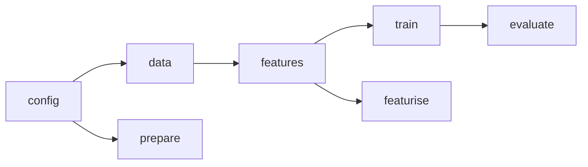

# Worked example · From one script to five modules

The legacy script below is the state RaviRide is actually in. It was run before and after the refactor described here; both produced the same metric, which is the only acceptable definition of "behaviour preserved".

## The starting point

```python
# legacy_train.py  (48 lines, one path, three hard-coded choices)
import pandas as pd, numpy as np
from sklearn.compose import ColumnTransformer
from sklearn.ensemble import RandomForestRegressor
from sklearn.metrics import mean_absolute_error
from sklearn.pipeline import Pipeline
from sklearn.preprocessing import OneHotEncoder

df = pd.read_csv("data/raw/trips.csv", parse_dates=["requested_at"])
df["hour"] = df["requested_at"].dt.hour
df["day_of_week"] = df["requested_at"].dt.dayofweek
df["is_weekend"] = (df["day_of_week"] >= 5).astype(int)
df["is_peak"] = df["hour"].isin([7, 8, 9, 17, 18, 19]).astype(int)
df["log_distance"] = np.log(df["distance_km"].clip(lower=0.1))
df = df.sort_values("requested_at").reset_index(drop=True)
cutoff = df["requested_at"].max().floor("D") - pd.Timedelta(6, unit="D")
train, test = df[df["requested_at"] < cutoff], df[df["requested_at"] >= cutoff]
num = ["distance_km", "passengers", "hour", "day_of_week", "is_weekend",
       "is_peak", "log_distance", "traffic_index", "driver_supply"]
cat = ["pickup_zone", "dropoff_zone", "weather"]
pre = ColumnTransformer([("n", "passthrough", num),
                         ("c", OneHotEncoder(handle_unknown="ignore"), cat)])
model = Pipeline([("pre", pre), ("rf", RandomForestRegressor(
    n_estimators=200, max_depth=12, min_samples_leaf=3,
    random_state=42, n_jobs=1))])
model.fit(train[num + cat], train["duration_min"])
pred = model.predict(test[num + cat])
print("rows", len(train), len(test),
      "MAE", round(mean_absolute_error(test["duration_min"], pred), 3))
```

```text
rows 896 304 MAE 2.777
```

Now count what is wrong with it, without running anything:

| Observation | Category | Why it costs later |
|---|---|---|
| Path is relative to wherever you happen to be | Configuration | Fails from another directory; impossible to run in a scheduled job |
| `6` days and the peak-hour list are inline | Configuration | Changing the window means editing code |
| Everything runs on import | Structure | Cannot import to test one part |
| Features, split, fit, and metric in one scope | Structure | A test of the split must refit the model |
| No way to load the trained model afterwards | Structure | Serving code will reimplement prediction |
| Numeric and categorical column lists duplicated in the notebook | Glue | Two lists drift apart silently |

## Target structure

```text
src/raviride_eta/
├── config.py      # paths, params loader
├── data.py        # load + validate
├── features.py    # pure transforms, feature set declarations
├── prepare.py     # stage: split
├── featurise.py   # stage: materialise features
├── train.py       # stage: fit + write artefact
└── evaluate.py    # stage: predict + metrics
```

The import graph is a straight line - `config` at the bottom, `evaluate` at the top - and the stages are thin entry points over the library code:



## The three moves that matter

**1. Literals become parameters.** The test window, peak hours, and model settings move to `params.yaml`:

```yaml
data:
  test_days: 7
model:
  n_estimators: 200
  max_depth: 12
  min_samples_leaf: 3
  random_state: 42
```

The cutoff calculation now reads `test_days` from configuration. Note that the default is still 7; the refactor did not change the behaviour, only where the value comes from.

**2. Column lists become declarations.** `features.py` owns them:

```python
FEATURE_SETS = {
    "full": {
        "numeric": ["distance_km", "passengers", "hour", "day_of_week", "is_weekend",
                    "is_peak", "log_distance", "traffic_index", "driver_supply"],
        "categorical": ["pickup_zone", "dropoff_zone", "weather"],
    },
}
```

Training and evaluation now ask for `"full"` rather than each carrying a copy. A test asserts the leaky column is absent from every set (Module 07 writes it).

**3. The script becomes a stage.** `prepare.py` does the split and writes two files; `train.py` fits and writes `model.joblib`; `evaluate.py` reads both and writes `metrics.json`. Each is runnable on its own, and each is wrappable by a pipeline (Module 05).

## Proving the refactor

The comparison that counts is not "the code looks better":

| Version | Command | Rows train/test | MAE |
|---|---|---|---|
| Legacy script | `python legacy_train.py` | 896 / 304 | **2.777** |
| Refactored package | `python -m raviride_eta.evaluate` after the pipeline | 896 / 304 | **2.777** |

Identical to three decimals, on identical rows. That is what "behaviour preserved" means, and it is the evidence a reviewer should demand before approving a structural change.

If your numbers differ, the cause is almost always one of: a different split boundary (inclusive versus exclusive `<`), a different row order before splitting, a changed random seed, or a feature list that quietly gained or lost a column. Compare the two dataframes before debugging the model.

## What the refactor did not fix

Honesty section, and the reason the debt register exists:

- The data is still unvalidated; a negative distance would flow into training. Module 04 fixes this.
- Stages are run by hand; nothing records which run produced which metric. Module 05.
- No run comparison, no baseline. Module 06.
- No tests beyond a smoke test. Module 07.

A refactor that claims to fix everything is a refactor that hid something. List what remains; it becomes the next module's agenda.
