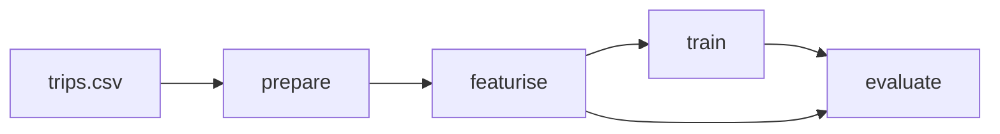

# Worked example · A pipeline that knows what changed

The reference project has four stages. This page shows the definition, then three runs: fresh, cached, and invalidated. The outputs are from the reference implementation on the course dataset.

## The stage graph

```yaml
stages:
  prepare:
    cmd: python -m raviride_eta.prepare
    deps:
      - data/raw/trips.csv
      - src/raviride_eta/prepare.py
      - src/raviride_eta/data.py
      - src/raviride_eta/config.py
    params:
      - data.test_days
      - data.window_start
      - data.window_end
    outs:
      - data/processed/train.csv
      - data/processed/test.csv

  featurise:
    cmd: python -m raviride_eta.featurise
    deps:
      - data/processed/train.csv
      - data/processed/test.csv
      - src/raviride_eta/featurise.py
      - src/raviride_eta/features.py
    outs:
      - data/features/train.csv
      - data/features/test.csv

  train:
    cmd: python -m raviride_eta.train
    deps:
      - data/features/train.csv
      - src/raviride_eta/train.py
      - src/raviride_eta/features.py
      - src/raviride_eta/config.py
    params:
      - features.set
      - model
    outs:
      - models/model.joblib
      - models/run_meta.json

  evaluate:
    cmd: python -m raviride_eta.evaluate
    deps:
      - models/model.joblib
      - data/features/test.csv
      - src/raviride_eta/evaluate.py
    params:
      - features.set
    metrics:
      - metrics.json:
          cache: false
```

`cache: false` on the metrics file is deliberate: metrics should be readable and diffable in Git, not stored as a binary cache object.

## Run 1: from a clean cache

```powershell
Remove-Item -Recurse -Force .dvc\cache, data\processed, data\features, models, metrics.json
dvc repro
```

```text
Verifying data sources in stage: 'data\raw\trips.csv.dvc'

Running stage 'prepare':
> python -m raviride_eta.prepare
PASS data/raw/trips.csv: 1200 rows, 8 checks
train: 896 rows 2026-09-01 02:56:00 .. 2026-09-21 23:36:00
test:  304 rows 2026-09-22 02:04:00 .. 2026-09-28 23:23:00
cutoff: 2026-09-22 00:00:00

Running stage 'featurise':
> python -m raviride_eta.featurise
train: 896 rows, added ['hour', 'day_of_week', 'is_weekend', 'is_peak', 'log_distance'] -> train.csv
test: 304 rows, added ['hour', 'day_of_week', 'is_weekend', 'is_peak', 'log_distance'] -> test.csv

Running stage 'train':
> python -m raviride_eta.train
trained full model on 896 rows -> model.joblib

Running stage 'evaluate':
> python -m raviride_eta.evaluate
test rows: 304
MAE 2.777 min | RMSE 5.259 | R2 0.8298 | p95 8.977 min
...
wrote metrics.json
```

Note that validation ran inside `prepare` and rejected nothing: a corrupt batch would stop the pipeline here, before any training.

## Run 2: nothing changed

```text
'data\raw\trips.csv.dvc' didn't change, skipping
Stage 'prepare' didn't change, skipping
Stage 'featurise' didn't change, skipping
Stage 'train' didn't change, skipping
Stage 'evaluate' didn't change, skipping
Data and pipelines are up to date.
```

The elapsed time for this run was dominated by DVC's own startup, not by Python. That is the intended outcome.

## Run 3: one parameter changes

Change `model.n_estimators` from 200 to 120:

```powershell
dvc repro
```

```text
Stage 'prepare' didn't change, skipping
Stage 'featurise' didn't change, skipping
Running stage 'train':
> python -m raviride_eta.train
trained full model on 896 rows -> model.joblib
Updating lock file 'dvc.lock'

Running stage 'evaluate':
> python -m raviride_eta.evaluate
test rows: 304
MAE 2.787 min | RMSE 5.292 | R2 0.8277 | p95 9.24 min
```

Two stages reran, for an obvious reason: `prepare` does not declare `model.*` and its inputs did not change; `evaluate` reran because its dependency `models/model.joblib` changed.

Predict this before you run it. If you expect `prepare` to rerun, you do not yet have the dependency graph in your head, and that is the skill the module is teaching.

## The DAG

```powershell
dvc dag --mermaid
```

```text
flowchart TD
    node1["data\raw\trips.csv.dvc"]
    node2["evaluate"]
    node3["featurise"]
    node4["prepare"]
    node5["train"]
    node1-->node4
    node3-->node2
    node3-->node5
    node4-->node3
    node5-->node2
```

(The separators follow your platform; on Linux the same command prints forward slashes.) Rendered, it is the pipeline from [Concepts](concepts.md):



## Proving determinism

```powershell
python -m raviride_eta.train
python -m raviride_eta.evaluate
(Get-FileHash models/model.joblib -Algorithm SHA256).Hash
```

On the reference implementation, two independent runs produced:

| Check | Result |
|---|---|
| `metrics.json` | byte-identical (`diff` produced no output) |
| `models/model.joblib` SHA-256 | `0074f0257091bd0baee70cae9231470fb7ed3d7c1a34498856642f8466410d86` in both runs |
| Rows trained | 896 in both |

Byte-identical artefacts are a strong result and not guaranteed across libraries or platforms. What *is* guaranteed is the ability to notice: without the hash comparison, "it looks the same" is the whole evidence.

## What `dvc.lock` adds

`dvc.lock` records the resolved hashes for each stage: the command, the dependency hashes, the parameter values, and the output hashes. Committing it means a colleague can check out the exact combination you ran, and DVC will refuse to pretend a stale output is current.

If `dvc.lock` and `dvc.yaml` disagree, DVC tells you the pipeline is not reproduced. Do not hand-edit either file; run `dvc repro`.

## What this pipeline still cannot tell you

- Which run was better, and why. That is Module 06.
- Whether the model is correct on segments that matter. The metrics file has the raw material; the evaluation design does not exist yet.
- Whether the code is tested. Module 07.

Caching makes iteration cheap. It does not make a bad experiment informative.
