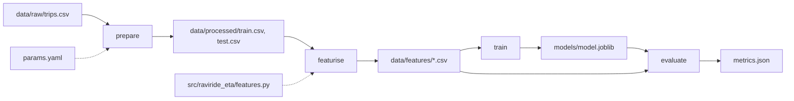
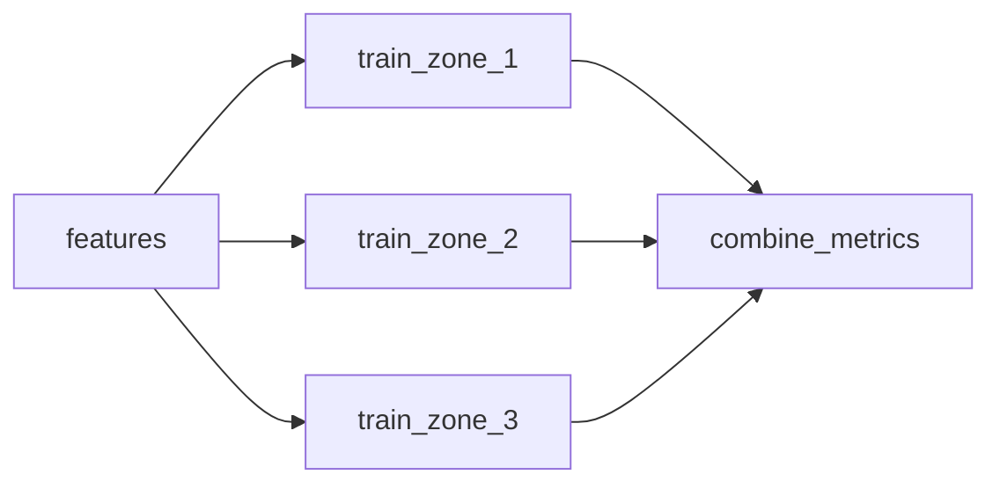

# Concepts · Pipelines that know what changed

## 1. From an ordered list to a declared graph

Module 05 produced four commands that must run in a particular order. Order is not the same as dependency. Two differences matter:

- **Order is implicit.** Nothing in `python -m raviride_eta.train` says it needs `data/features/train.csv`; that fact lives in someone's memory.
- **Order cannot answer "what is stale?"** A person decides. A declaration lets a tool decide, using content, not assumptions.

A **stage** is a command plus a declaration of everything that affects its output:

```yaml
train:
  cmd: python -m raviride_eta.train
  deps:                                  # files whose content changes the output
    - data/features/train.csv
    - src/raviride_eta/train.py
    - src/raviride_eta/features.py
  params:                                # values from params.yaml the stage reads
    - features.set
    - model
  outs:                                  # files the stage produces
    - models/model.joblib
    - models/run_meta.json
```

Read that block as a claim: *given these bytes and these parameters, this command produces these outputs*. Everything else in this module follows from taking that claim seriously.

A **dependency** is an input edge; an **output** is a result edge. Together they form a **directed acyclic graph** (DAG) — directed because dependencies flow one way, acyclic because a stage that feeds itself could never start.



The dotted edges are not less important than the solid ones. A missing dotted edge is the most common cause of a pipeline that "works" on the author's machine.

## 2. The cache key, and why it is a hash of content

DVC does not compare modification times. It computes a hash of each dependency's content and each parameter value, combines them with the command, and stores the result in `dvc.lock`. That combination is the stage's **cache key**.

```text
key = hash(command, sorted(dep hashes), sorted(param values))
```

Consequences worth memorising:

| Situation | Cache key | Result |
|---|---|---|
| You edit a comment in `train.py` | changes | stage reruns (safe over-invalidation) |
| You touch a file without changing bytes | unchanged | stage skipped |
| You change `model.n_estimators` | changes | stage reruns |
| You change a dependency of `prepare` | `prepare` key changes | downstream keys change too, because their input hashes change |
| You delete an output | unchanged | output is restored from cache, stage does not run |

That last row surprises people. **A cached result is not a run.** If DVC can find the key in its cache, it copies the outputs back; nothing executes. This is why deleting `data/processed/` and running `dvc repro` is fast and why it does not prove the code still works. To prove that, force a real run:

```powershell
dvc repro --force
```

## 3. Three things a rerun can do

When you type `dvc repro`, each stage is in exactly one of three states:

1. **Skipped** — key matches the lock file, outputs exist and match. Nothing happens.
2. **Checked out** — key matches the lock file, outputs are missing or corrupt. Files are restored from cache.
3. **Recomputed** — key differs. The command runs.

The distinction matters during an incident. "It said up to date" can mean "the artefact is the one this code produces" or "the artefact is from last Tuesday and the code has since changed but nobody touched `dvc.lock`". The lock file is the record; commit it with `dvc.yaml` in the same commit, or the two disagree.

## 4. What belongs in `deps`, and the hidden-input problem

Rule: **if the stage reads it and it can change, declare it.** In practice:

- data files it opens;
- every source file it imports, directly or transitively;
- configuration it reads (`params.yaml` entries, not the whole file);
- the Python environment, indirectly — DVC does not hash your installed packages, which is why Module 11 exists.

A **hidden input** is a file the stage reads but does not declare. Its effect is not "the rerun is slow"; it is "the rerun is confidently wrong". Example: `train.py` imports `features.py`, but `deps` lists only `train.py` and the training CSV. You change `add_features` to add a column, run `dvc repro`, and DVC reports everything up to date — serving a model trained on the old features while `metrics.json` claims to describe the new code.

Over-declaring has a smaller cost: listing `features.py` under `prepare` makes `prepare` rerun when features change. Wasteful, visible, harmless. Under-declaring is invisible and dangerous. When unsure, declare.

## 5. Failure propagation and exit codes

A process communicates success through its **exit code**: `0` means success, anything else means failure. Every shell, CI system, and orchestrator keys off this one integer.

DVC runs stages in dependency order and stops at the first non-zero exit:

```text
Running stage 'evaluate':
> python -m raviride_eta.evaluate
Traceback (most recent call last):
  ...
RuntimeError: simulated upstream schema change: column traffic_index missing
ERROR: failed to reproduce 'evaluate': failed to run: python -m raviride_eta.evaluate, exited with 1
```

Three facts to read from that output:

1. The failing stage is named: `evaluate`.
2. The *stage* exited `1`; `dvc repro` itself exits non-zero (255 on the version used here) to say "the pipeline failed". Wrappers should propagate, not reinterpret.
3. `train` was skipped, so `models/model.joblib` is the previous good artefact. It was not overwritten.

That last point is **fail-fast** behaviour: stop at the first failure, leave earlier outputs intact, and do not run stages whose inputs are now suspect. The alternative, **fail-safe**, continues with a warning and produces a partial result. For model pipelines, fail-fast is almost always right: a silently partial feature table trains a model that is wrong in a way no downstream check expects.

Python makes this easy to get wrong:

```python
subprocess.run(["python", "-m", "raviride_eta.evaluate"])   # exit code discarded
```

The script continues, the pipeline reports success, and a missing `metrics.json` is discovered by the release job three hours later. Always check the code, or use `check=True`.

## 6. Partial artefacts and atomicity

A stage that dies halfway may leave a half-written output. Consider `featurise` writing `train.csv` then failing on `test.csv`. The next run sees a changed input and reruns — fine. But if the stage wrote the file and exited `0` after a partial write (disk full, killed process), the next run may treat a truncated file as current.

Two defences, both cheap:

- **Write then rename.** Write to `name.tmp`, `os.replace()` to the final name. Rename is atomic on the same filesystem, so readers see either the old file or the complete new one.
- **Do not write `metrics.json` until every metric is computed.** A metrics file that exists but is half-populated is worse than no file, because the gate reads it.

DVC's own cache provides a third: outputs are copied into the cache by hash, and an interrupted checkout does not update the lock file until the stage completes.

## 7. Idempotency and resumability

**Idempotent**: running twice produces the same result as running once. Every stage in this project is idempotent — it reads inputs, computes, and overwrites outputs deterministically. That is what makes a mid-pipeline failure boring instead of dangerous.

**Resumable**: a rerun after failure does the remaining work and no more. DVC gives this for free *because* stages are declared: completed stages have matching keys and are skipped.

The pair has a practical consequence for how you debug:

| After a failure in… | A correct rerun should… |
|---|---|
| `prepare` | rerun everything |
| `featurise` | skip `prepare`, rerun `featurise` onward |
| `train` | skip `prepare` and `featurise`, rerun `train` onward |
| `evaluate` | skip the first three, rerun `evaluate` |

If your rerun does more than the table says, a dependency is wrong. If it does less, an output was left in a state DVC considers valid — check the lock file and the file's hash.

## 8. Fan-out, fan-in, and the shape of a real graph

Production graphs branch. Training a model per zone is **fan-out**; combining their metrics is **fan-in**:



Two properties are worth knowing before you build one:

- **Fan-out multiplies cost, not correctness.** Three zone models triple training time; a failure in one blocks the merge unless you design partial success deliberately.
- **Fan-in hides partial failure unless you check it.** `combine_metrics` must fail when an input is missing, not average the two it found.

The reference project stays linear on purpose. Most teams need a straight line plus one branch, and a graph you can draw on a napkin is a graph you can debug at 2 a.m.

## 9. Commit-time hooks

Tests and pipelines run *after* a change exists. **Hooks** run at the moment of commit, before the change becomes history. They are cheap, local, and useful for the class of mistake that should never reach a reviewer: a 6 MB data dump, trailing whitespace, a YAML file that does not parse, a private key.

`pre-commit` runs the configured hooks against staged files:

```yaml
repos:
  - repo: https://github.com/pre-commit/pre-commit-hooks
    rev: v4.6.0
    hooks:
      - id: trailing-whitespace
      - id: end-of-file-fixer
      - id: check-added-large-files
        args: ["--maxkb=5000"]
      - id: check-yaml
```

Hooks are not a security boundary. `git commit --no-verify` bypasses them, so the same checks belong in CI (Module 12). Their value is speed of feedback, not enforcement.

## 10. The one command

A pipeline becomes operable when there is a single documented entry point that:

1. **checks its own preconditions** (right Python, `dvc` available, input files present, params parse);
2. **runs the graph** with the project's environment;
3. **records what happened** (timestamped log, exit code, elapsed time);
4. **returns a meaningful exit code** — `0` success, `1` pipeline failure, `2` preflight failure.

Separating `1` from `2` is a small decision with a real payoff: a scheduler or a colleague can tell "the data is missing" from "the model training crashed" without reading the log.

The reference entry point is `run_pipeline.py`:

```powershell
python run_pipeline.py --check
```

```text
PASS data/raw/trips.csv: 1200 rows, 8 checks
Stage 'prepare' didn't change, skipping
...
Data and pipelines are up to date.
summary['exit_code']=0 summary['elapsed_s']=1.5s log=logs\pipeline-20261024T024010Z.log
```

It is not clever. That is the point: every reader can see what it does, and it does the same thing when a scheduler runs it at 3 a.m.

## 11. Common mistakes and what they look like

| Mistake | Symptom | Diagnosis |
|---|---|---|
| Relative paths | Works in one shell, fails in another | Run from a different directory; anchor to the project root |
| Missing `deps` entry | "Up to date" after a real code change | Compare `dvc.lock` hashes before and after the edit |
| Volatile file in `deps` | Everything reruns every time | Look for a log or timestamp in `deps` |
| Ignoring exit codes | Pipeline "succeeds" with stale metrics | Search for `subprocess.run` without `check=True` |
| Metrics written before validation | Gate passes on nonsense | Read `metrics.json` from a failed run |
| Pipeline depends on an activated shell | Works for you, fails in CI | Call the interpreter by absolute path, or activate inside the entry script |

## 12. What this module does not solve

Declared stages make a *single-machine* run repeatable. They do not schedule it (Module 13), do not make the environment reproducible (Module 11), do not run it on a fresh machine without the data cache (Module 12), and do not tell you whether the result is good (Modules 06 and 09). Keep those boundaries clear, or you will expect the DAG to do work that belongs to a container, a workflow, or a gate.
