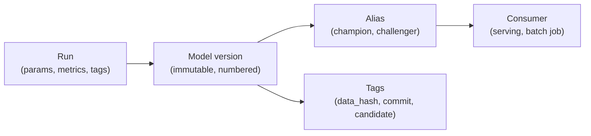

# Concepts · Artifacts, versions, and the right to ship

## 1. Artifact, model, version

An **artifact** is any file a run produces: a metrics table, a plot, a serialised model. A **model artifact** is the specific artifact that can turn a request into a prediction without access to the training data or the training code.

A **version** is an immutable snapshot in a registry. It has a number, a creation time, a link to the run that produced it, and a set of tags. "Immutable" is the load-bearing word: v3 means the same bytes forever. If you need different bytes, you create v4.

Teams that skip the registry usually have a folder:

```text
models/
├── model.joblib
├── model_v2.joblib
├── model_final.joblib
└── model_final_USE_THIS_one.joblib
```

Every file is mutable, none records its inputs, and the newest filename is a claim rather than a fact. The registry replaces the naming convention with a data structure.

## 2. What must be inside a model artifact

`joblib.dump(model)` saves a scikit-learn object. That is necessary and not sufficient. A shippable artifact needs:

| Component | Why it must travel with the model |
|---|---|
| Fitted preprocessing | A model trained on scaled or one-hot features is useless without the same transform |
| Feature order and names | Column order is not stored in a bare estimator call; a reordered frame silently changes predictions |
| **Signature** | Declares input types and output type so the loader can reject a bad request |
| Input example | Documents a valid request and enables signature inference |
| Metadata | Dataset hash, commit, parameters, library versions, training rows |
| The code to load it | A documented, versioned loading path — not "import the training module" |

In the reference project the whole scikit-learn `Pipeline` is saved, not just the forest. The `ColumnTransformer` inside it is why the artifact can preprocess by itself:

```python
model = Pipeline([("pre", pre), ("rf", forest)])
joblib.dump(model, "models/model.joblib")
```

A **signature** is the artifact's half of the API contract:

```text
inputs:  [requested_at: string, pickup_zone: string, distance_km: double, ...]
outputs: [variable: double]
```

It does not validate business rules — a distance of `-3` is still a double — but it catches structural mistakes: a missing column, a string where a number belongs, a batch sent one at a time. Module 10 adds the business validation on top.

**Why it matters later:** a model that loads only when the training package is installed is not an artifact; it is a reference to your repository. The test is simple: copy the artifact to a machine with scikit-learn but without `src/raviride_eta/`, and load it.

## 3. The registry's data model

Four objects, each with one job:



- **Registered model** — the name (`raviride-eta`), a container for versions.
- **Model version** — one immutable snapshot, numbered 1, 2, 3… It links to the run that produced it.
- **Alias** — a mutable pointer with a stable name, such as `champion`. Exactly one version at a time.
- **Tags** — key/value metadata on a version or a run. This is where provenance lives.

The split between immutable versions and a mutable pointer is the whole design. Consumers ask for `models:/raviride-eta@champion`; they never hard-code a number. Promotion changes the pointer, not the artifact.

## 4. Aliases, not stages

Older MLflow versions used **stages**: `Staging`, `Production`, `Archived`. They are deprecated, and teaching them today would teach a convention that is already fading. The reasons are worth knowing because they generalise:

- A stage implies a single linear lifecycle, but real lifecycles branch (a regional model, a shadow deployment, a canary).
- A stage is one value per version, so two teams cannot use the same version differently.
- Stage transitions were not designed as auditable decisions.

Aliases are just labels, so you can have `champion`, `challenger`, `canary`, `eu-west`, and `last-known-good` simultaneously. The discipline moves from the tool to the policy, which is where it belongs.

## 5. Promotion is a decision, not a rename

Promotion answers: *may this version take traffic from the current champion?* A credible answer needs gates that a machine evaluates, because a human under deadline pressure will rationalise.

Gates fall into four families:

| Family | Example | What it prevents |
|---|---|---|
| **Absolute** | `mae <= 3.20` | Shipping something that is bad in absolute terms |
| **Relative** | `mae <= champion.mae * 1.03` | Shipping a regression because the ceiling was generous |
| **Slice** | `mae_zone_Z07 <= champion_z07 * 1.05` | A better average that is worse for a group of users |
| **Provenance** | `data_hash` present; no production zone dropped | A model trained on the wrong or partial data |

The reference policy:

```yaml
overall_ceiling: 3.20
max_regression: 0.03
zone_limits:
  Z01: 0.05
  Z05: 0.05
  Z07: 0.05
  Z08: 0.08
forbid_dropped_zones: true
```

Read it as an argument: 3% average regression is tolerable; a 5% regression in a specific zone is not; the two sparse zones get 5% and 8% because 16 and 22 test rows cannot support tighter bounds; and a candidate trained without a production zone is never eligible, regardless of its numbers.

Note that the last rule is not about performance at all. That is the point of §7.

## 6. The aggregate hides the population

The reference candidates make this concrete. Version 4 had the **best overall MAE of every candidate** — 2.7275 against the champion's 2.7557 — and was rejected:

```text
FAIL
  - zone Z07 mae 5.512 exceeds champion 5.179 by more than 5% (allowed 5.4382)
```

With 16 Z07 rows in the test set, that is a real but uncertain regression: the aggregate improved because other zones improved more. Whether to ship it is a product question, not a statistics question. The gate encodes the current answer: not yet. A team that decides Z07 matters less can change the policy deliberately and record why.

This is also why slice metrics must carry **row counts**. Without them, `5.512` looks as trustworthy as `1.906`, when one rests on 16 rows and the other on 68.

## 7. Provenance gates and the incident that adds them

Version 5 in the reference run passed every numeric gate and was promoted. Its training data had been filtered to remove Z08 — a defensible-looking "outlier removal" that quietly deleted a production zone. Numeric gates could not see it: Z08's test error rose by 6.2%, inside the 8% tolerance, and the overall metric was fine.

The fix is a provenance gate, added after the incident:

```text
FAIL
  - training data excludes production zones: Z08
```

Policies accumulate rules this way, and that is healthy: each incident leaves behind a check that makes the same incident impossible. The unhealthy version is a policy that grows rules nobody understands; each gate should name the failure it prevents.

The broader lesson: **registries make lineage inspectable, but they do not inspect it for you.** Someone has to decide that "no production zone may be missing" is a rule, and encode it.

## 8. Approval, break-glass, and the audit trail

Some organisations require a human approval before `champion` moves. That is compatible with automatic gates: the gates decide eligibility, the human decides timing.

The failure mode to design against is the **silent override**. A `--force` flag that promotes anything, used at 2 a.m., with no record, converts the policy into decoration. If an override must exist, make it expensive and visible:

- require a written reason;
- record it as a tag (`override_reason`, `approved_by`, `promoted_at`);
- emit it in the deployment log;
- review overrides monthly, because a policy that is overridden weekly is a policy that is wrong.

## 9. Rollback: fast, necessary, and incomplete

Rollback moves the alias back to a version that worked:

```text
rolled back: v5 -> v2
```

Measured end-to-end: 2.1 seconds for the command, 25 ms for the alias write itself, 1.5 ms to read the alias back. Fast, because nothing is rebuilt — the artifact already exists.

What rollback does **not** do:

- It does not fix a bad **artifact** that is already loaded in a running process (a server needs a reload; Module 10 discusses this).
- It does not undo a bad **dataset**: if the new model wrote predictions, caches, or downstream records, those remain.
- It does not fix the **cause**. If v5 shipped because the policy lacked a provenance gate, rolling back restores service and leaves the defect in place until the gate is added.
- It does not help if the previous version is also broken by a change outside the model — a feature-pipeline change that alters inputs affects every version.

A rollback is an incident response, not a repair. Write down both parts: the action, and the follow-up.

## 10. Lineage: the chain that answers "what is live?"

A complete chain for the reference champion:

```text
alias champion
  -> version 2
    -> run cf6b16d6
      -> params: n_estimators=300, max_depth=16, min_samples_leaf=1
      -> tags: data_hash=285bbf8406f483a9, git_commit=ac4246f
      -> artifacts: model/ (signature, input example)
```

Given an incident, each link answers a different question:

| Question | Link |
|---|---|
| What is serving? | alias → version |
| How was it trained? | version → run → params |
| On what data? | run → `data_hash` → dataset version |
| From what code? | run → `git_commit` |
| Can I reproduce it? | all of the above, in a clean environment |

The chain is only as good as the metadata someone remembered to log. A registry with versions but no dataset hash answers "which file?", not "which data?".

## 11. Local registry versus production registry

MLflow's file store is a directory of JSON and artifacts. It is excellent for learning and for a single developer, and it is not a production registry.

| Capability | Local file store | Server-backed registry |
|---|---|---|
| Versions and aliases | Yes | Yes |
| Concurrent writers | No safe coordination | Transactional database |
| Authentication / RBAC | None | Yes |
| Artifact storage | Local disk | Object store (S3, GCS, Azure) |
| Audit log | File history at best | Yes |
| High availability | No | Yes |
| Cost | Free | Server, database, storage |

The concepts transfer unchanged, which is why this module teaches them locally. The honest limitation to write down: **two people running the reference registry script against the same `mlruns/` directory can corrupt each other's state**, and nothing here authenticates who promoted what.

## 12. Common failure modes

| Failure | What it looks like | Prevention |
|---|---|---|
| Mutable artifact | `model.joblib` overwritten in place | Version everything; never reuse a path for a new model |
| Alias used as a version | Code hard-codes `@champion` in an evaluation | Pin versions in evaluation; aliases only at the serving boundary |
| Gate on aggregate only | Best MAE ships, one zone regresses | Slice gates with row counts |
| Missing signature | Server accepts malformed input | Log with `signature` and `input_example` |
| No provenance | Cannot answer "which data?" | Log data hash, commit, and segment coverage |
| Silent override | `--force` in the release script | Break-glass with recorded reason |
| Rollback untested | Discover at 3 a.m. that the alias API changed | Rehearse quarterly and time it |
| Unpickling across versions | Model loads on the training machine only | Pin library versions; test load in a clean environment (Module 11) |

## 13. What this module does not decide

The registry says *which* model may serve. It does not say whether serving is healthy (Module 14), whether the artifact runs in a different environment (Module 11), or whether the request schema is valid (Module 10). Keep those boundaries: a registry that is asked to do monitoring becomes a registry nobody trusts.
