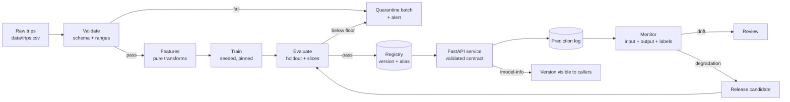

# Architecture diagram template

> Copy this into `docs/architecture.md` in your project. One diagram, one page of
> explanation, and a list of the decisions the diagram does not show.

---

## 1. The diagram

Use Mermaid, Graphviz, or a hand-drawn image saved as `docs/architecture.png`.
Mermaid renders on this site and in GitHub, so it is the least fragile choice.

Rules for the diagram:

- **Every arrow labels what moves** — a file, a request, an event.
- **Every external system is drawn** — object store, registry, database.
- **Failure paths are drawn**, or listed separately if the diagram becomes
  unreadable.
- **No more than twelve boxes.** A diagram with forty boxes is a map nobody can
  read during an incident.

---

## 2. The parts, in one table

| Component | Technology | Responsibility | Fails how |
|---|---|---|---|
| Ingest | Python script | Fetch and hash the batch | Missing file, schema change |
| Validate | pandas checks | Reject bad rows before training | False pass if a check is missing |
| Train | scikit-learn | Fit and persist the artifact | Nondeterminism, version drift |
| Registry | MLflow (or local JSON) | Version, alias, lineage | Alias points at a deleted artifact |
| Service | FastAPI + Uvicorn | Validate and predict | Start-up failure, slow model |
| Monitor | Python + PSI | Detect input and outcome change | Alert fatigue, stale reference |

*"Fails how" is not optional. A component with no failure mode has not been
thought about.*

---

## 3. Two decisions the diagram cannot show

Write two short paragraphs. Each names the alternative you rejected.

**Decision 1 — where preprocessing lives.** *Example: inside the sklearn pipeline
rather than in a separate prepared file, because serving must recompute the same
transforms and a separate file can drift. Cost: retraining is required to change a
transform.*

**Decision 2 — how the model reaches the service.** *Example: baked into the image
rather than loaded from a registry at start-up, because it removes a runtime
dependency and makes rollback a deploy. Cost: a new model needs a new image, which
is acceptable at this release cadence.*

Format:

> We chose **X** over **Y** because **evidence**. The cost is **Z**, which we accept
> because **reason**.

---

## 4. Boundaries and trust

| Boundary | What crosses it | Trust assumed |
|---|---|---|
| Caller → service | JSON request | Authenticated at the gateway; not trusted for schema |
| Service → registry | Artifact read | Read-only credential |
| Pipeline → object store | Dataset read/write | Scoped to one prefix |
| Monitor → logs | Prediction records | No personal data in the payload |

*Draw the trust boundaries. A diagram that shows only data flow hides the part
that matters for security.*

---

## 5. What the diagram omits

List three things deliberately left out, with the reason: a batch endpoint, a
feature store, a second region. Omission is a decision and should be visible.

---

## Checklist

- [ ] Every arrow is labelled with what moves.
- [ ] At most twelve boxes; failure paths shown or listed.
- [ ] Each component has a named failure mode.
- [ ] Two decisions include the rejected alternative and its cost.
- [ ] Trust boundaries are shown.
- [ ] Omissions are stated.
- [ ] The diagram matches the code: every box exists in the repository.
